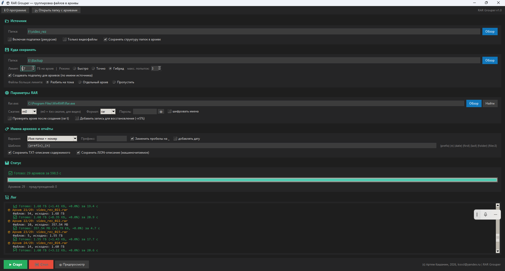

# RAR Grouper v1.1

**Умная группировка файлов в архивы по лимиту размера**

---

## Зачем эта программа

Когда нужно залить много больших файлов (видео, бэкапы, образы дисков) в облако или Telegram, стандартный архиватор предлагает два неудобных пути:

1. Сделать один гигантский архив и потом порезать его на куски.
2. Сразу разбить на тома (`part1`, `part2`, `part3`...).

В обоих случаях, чтобы достать **один** нужный файл, придётся скачать **весь** архив целиком. Это долго, дорого и неудобно.

**RAR Grouper** решает эту проблему иначе: он создаёт **много самостоятельных, независимых архивов**. Вы указываете папку с файлами и желаемый размер архива (например, 3 ГБ). Программа сама набирает в каждый архив столько файлов, сколько влезает в лимит, и создаёт следующий. Каждый архив можно скачать отдельно — не нужно тянуть всё сразу.

---

## Основные возможности

- [x] Группировка файлов в независимые архивы по заданному лимиту (ГБ).
- [x] Три режима: «Быстро», «Точно», «Гибрид» (см. ниже).
- [x] **Семь вариантов** автоматического именования архивов.
- [x] Автоматическая замена пробелов на `_` в именах архивов (для облаков).
- [x] Обработка файлов больше лимита: разбить на тома / отдельный архив / пропустить.
- [x] Рекурсивный обход подпапок (по желанию).
- [x] Фильтр «только видеофайлы» (mp4, mkv, avi, mov и др.).
- [x] Сохранение структуры папок внутри архива.
- [x] Уровень сжатия: `m0` (без сжатия), `m1`, `m3`, `m5`.
- [x] Пароль на архив и опциональное шифрование имён файлов (только RAR).
- [x] Формат: RAR (по умолчанию) или ZIP.
- [x] Данные для восстановления (`-rr5%`).
- [x] Проверка архива после создания (`rar t`).
- [x] **TXT-отчёт**: человекочитаемый список файлов в каждом архиве.
- [x] **JSON-отчёт**: машиночитаемый вариант для скриптов и поиска.
- [x] Предпросмотр разбиения до старта.
- [x] Создание подпапки для архивов (по имени источника).
- [x] Сохранение всех настроек между запусками.

---

## Системные требования

- **Windows** 7 / 8 / 10 / 11 (x64).
- Установленный **WinRAR** (нужен файл `Rar.exe`, обычно в `C:\Program Files\WinRAR\Rar.exe`).

---

## Быстрый старт

1. Запустите RAR Grouper (`RAR_Grouper.exe`).
2. В панели **«Источник»** укажите папку с файлами.
3. В панели **«Куда сохранять»** укажите папку для архивов.
4. Задайте лимит (например, **3.0 ГБ** на архив).
5. (Необязательно) Настройте параметры RAR, имена архивов, отчёты.
6. Нажмите **«👁 Предпросмотр»**, чтобы увидеть план разбиения.
7. Нажмите **«▶ Старт»**.

По завершении рядом с архивами появятся TXT- и JSON-отчёты со списком файлов. Загрузите их вместе с архивами в облако — и перед скачиванием сразу будет видно, что внутри.

---

## Режимы работы

| Режим | Описание |
| :--- | :--- |
| **Быстро** (`fast`) | Набор файлов по **сумме исходных** размеров. Архив создаётся один раз. Самый быстрый режим. Подходит для видео, так как оно почти не сжимается. |
| **Точно** (`exact`) | Пересборка архива с учётом **итогового** размера, чтобы максимально заполнить лимит. Медленнее. Имеет смысл для хорошо сжимаемых данных (текст, фото, документы). |
| **Гибрид** (`hybrid`, по умолчанию) | Быстрый набор + одна попытка дозаполнения, если архив получился заметно меньше лимита. Хороший компромисс между скоростью и плотностью. |

---

## Варианты имён архивов

| Вариант | Пример |
| :--- | :--- |
| По первым трём файлам | `video_001__video_002__video_003_001.rar` |
| Префикс + номер | `videos_001.rar` |
| Имя папки + номер | `MyVideos_001.rar` |
| По первому файлу | `IMG_2034.rar` |
| По диапазону чисел | `video_001-015.rar` |
| Дата + номер | `2026-11-16_001.rar` |
| Свой шаблон | `{prefix}_{n}.rar` |

### Плейсхолдеры для своего шаблона

- `{prefix}`  — префикс из поля «Префикс» (или имя папки-источника)
- `{folder}`  — имя папки-источника
- `{n}`       — номер набора (`001`, `002`, ...)
- `{date}`    — текущая дата (`ГГГГ-ММ-ДД`)
- `{first}`   — имя первого файла в наборе (без расширения)
- `{last}`    — имя последнего файла в наборе (без расширения)
- `{files3}`  — первые три имени через `__`

> Галочка **«Заменить пробелы на _»** (включена по умолчанию) убирает пробелы из имени архива — это полезно для облачных хранилищ и Telegram.

---

## Файлы больше лимита

Если отдельный файл больше заданного лимита, программа предложит три варианта:

- **Разбить на тома** — создать многотомный архив с томами по лимиту.
- **Отдельный архив** — положить файл в отдельный архив как есть (с предупреждением, если итог всё ещё больше лимита).
- **Пропустить** — не архивировать этот файл, записать в лог.

---

## Отчёты

### TXT-отчёт (`<имя_папки>_contents.txt`)
Человекочитаемый список: какой архив, сколько файлов, какие именно, размер каждого. Удобно открыть в Блокноте и посмотреть перед скачиванием.

### JSON-отчёт (`contents_ГГГГ-ММ-ДД.json`)
Машиночитаемый формат. Пригодится, если вы захотите написать скрипт для поиска «в каком архиве лежит файл X».

> Оба отчёта создаются в папке с архивами (или в подпапке, если включена опция «Создавать подпапку»).

---

## Часто задаваемые вопросы

**В: Можно ли использовать ZIP вместо RAR?**  
О: Да, но с оговорками. Для ZIP программа автоматически переключается на `WinRAR.exe` (потому что `Rar.exe` не умеет создавать ZIP). Шифрование имён файлов в ZIP не поддерживается — галочка автоматически отключается.

**В: Где взять Rar.exe?**  
О: Он устанавливается вместе с WinRAR. Обычно лежит в `C:\Program Files\WinRAR\Rar.exe`. Программа ищет его автоматически и показывает путь в панели «Параметры RAR». Если не нашла — нажмите «Найти» или укажите путь вручную через «Обзор».

**В: Почему архив получился чуть больше или чуть меньше исходников?**  
О: Видео практически не сжимается, поэтому размер архива почти равен сумме исходных файлов. Небольшая разница — это служебные заголовки RAR. Для хорошо сжимаемых данных (текст, фото) разница будет заметнее.

**В: Что будет, если файл занят другой программой?**  
О: Программа пропустит его, запишет в лог и продолжит работу. В конце вы увидите список предупреждений.

**В: Можно ли прервать работу?**  
О: Да, кнопкой «⏹ Стоп». Текущий недоделанный архив будет удалён, чтобы не оставлять мусор.

**В: Где хранятся настройки?**  
О: В файле `%USERPROFILE%\.rar_grouper_settings.json`. Он создаётся автоматически при первом запуске и обновляется при старте архивации.

**В: Программа что-то отправляет в интернет?**  
О: Нет. Всё работает локально. Интернет нужен только для открытия ссылок GitHub / Telegram из окна «О программе».

---

## Лицензия

Программа распространяется бесплатно, «как есть» (as is), без каких-либо гарантий.

Автор не несёт ответственности за любой ущерб, включая потерю данных, возникший в результате использования программы.

⚠️ ВСЕГДА ДЕЛАЙТЕ РЕЗЕРВНУЮ КОПИЮ ВАЖНЫХ ФАЙЛОВ.

## Связь с автором

E-mail: koscl@yandex.ru

GitHub: https://github.com/artemsoft2025/

Telegram: https://t.me/avhelpnew
